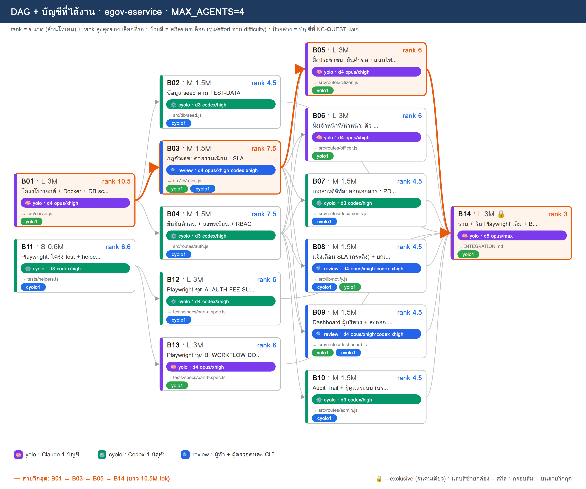
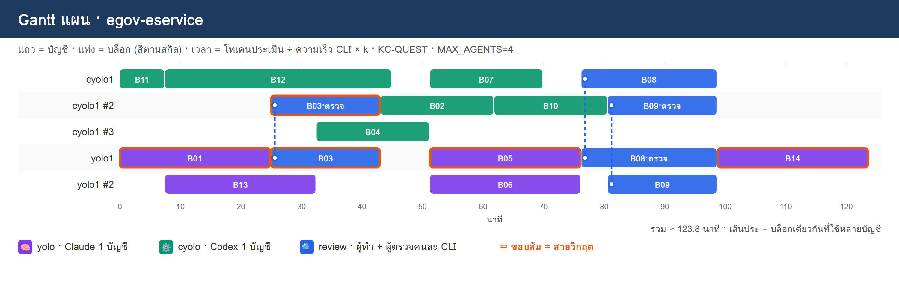

# PLAN · egov-eservice

**โจทย์:** สร้างเว็บ e-Service กลางของเทศบาลนครตัวอย่างตามชุดโจทย์ใน /workspace/egov-brief (อ่าน README.md ก่อน) ต้องทำตาม REQUIREMENTS.md CONTRACT.md TEST-DATA.md DECISIONS.md ครบทุกข้อ รันด้วย Docker Compose คำสั่งเดียว รองรับ TEST_MODE=1 และ BUG_MODE ตาม BUGS.md และมีชุด Playwright ครบ 51 TC ใน TEST-PLAN.md · stack กลางของทุกบล็อก: Node.js 20 + Express + better-sqlite3 (DB_PATH) + หน้า HTML render ฝั่งเซิร์ฟเวอร์ด้วย template literal (ไม่มี build step) + pdfkit + exceljs · เวลาอ่านจาก src/lib/clock.js เท่านั้น (Asia/Bangkok) · บั๊กเปิดผ่าน isBug('Bxx') ใน src/lib/bugs.js

วางแผนเมื่อ 15/11/2026 16:38 · MAX_AGENTS 4 · บัญชี cyolo1, yolo1 · ตัวปรับเวลา k (ยังไม่มี calib.json → k=1)

> แผนนี้ยังไม่ได้รันจริง — KC-QUEST เลือกบัญชีจากโควตา แล้วจำลองเวลาตาม dependency

## 1) โควตาของแต่ละบัญชี

| บัญชี | แพลน | ใช้ไป 5 ชม. | ใช้ไปสัปดาห์ | headroom | รีเซ็ต/หมดอายุ (ชม.) | U | slot | ที่มา |
|---|---|---|---|---|---|---|---|---|
| cyolo1 | default | 10% | 0% | **90%** | 168.0 | 0.125 | 3 | สมมติ (--accounts) |
| yolo1 | default | 20% | 0% | **80%** | 168.0 | 0.125 | 3 | สมมติ (--accounts) |

- ⚠ ทุกบัญชีเป็นค่าสมมติ (--accounts มี % ครบ) → ไม่ได้เรียก team.py check/quota

## 2) DAG + สกิล + บัญชี

**สายวิกฤต:** B01 → B03 → B05 → B14 · ยาว 10.5M tok

## 3) ตารางแจกงาน (เหตุผล KC-QUEST ทุกบล็อก)

| บล็อก | สกิล | ชื่อ | ขนาด · c | รอ | rank | บัญชี (บทบาท) | เริ่ม–จบ (นาที) | เหตุผล KC-QUEST |
|---|---|---|---|---|---|---|---|---|
| **B01** | 🧠 yolo | โครงโปรเจกต์ + Docker + DB schema + test hook | L · 3 | – | 10.5 | yolo1 (ทำ) | 0.0–25.0 | ทำ: yolo1 31.0 (U=0.125 F=0.01 S=0.722 S=1.0 L=0.0) · 3.00M ≈ 5ชม. 7.8% / สัปดาห์ 0.98% |
| B11 | ⚙️ cyolo | Playwright: โครง test + helper (อ่านแค่ TEST-PLAN/CONTRACT/TEST-DATA) | S · 0.6 | – | 6.6 | cyolo1 (ทำ) | 0.0–7.5 | ทำ: cyolo1 24.9 (U=0.125 F=0.002 S=0.884 S=0.44 L=0.0) · 0.60M ≈ 5ชม. 1.56% / สัปดาห์ 0.2% |
| B12 | ⚙️ cyolo | Playwright ชุด A: AUTH FEE SUBMIT UPLOAD PAY QUEUE SLA NOTI (22 TC) | L · 3 | B11 | 6 | cyolo1 (ทำ) | 7.5–45.0 | ทำ: cyolo1 23.3 (U=0.125 F=0.01 S=0.806 S=0.4 L=0.0) · 3.00M ≈ 5ชม. 7.8% / สัปดาห์ 0.98% |
| B13 | 🧠 yolo | Playwright ชุด B: WORKFLOW DOC PDPA DASH AUDIT RBAC NFR (29 TC) | L · 3 | B11 | 6 | yolo1 (ทำ) | 7.5–32.5 | ทำ: yolo1 20.1 (U=0.125 F=0.01 S=0.644 S=0.571 L=0.333) · 3.00M ≈ 5ชม. 7.8% / สัปดาห์ 0.98% |
| **B03** | 🔍 review | กฎตัวเลข: ค่าธรรมเนียม · SLA วันทำการ · ระดับเตือน · เลขคำขอ · อายุเอกสาร | M · 1.5 | B01 | 7.5 | yolo1 (ทำ), cyolo1 (ตรวจ) | 25.0–43.1 | ทำ: yolo1 21.6 (U=0.125 F=0.005 S=0.605 S=0.714 L=0.333) · 1.50M ≈ 5ชม. 3.9% / สัปดาห์ 0.49%   ตรวจ: cyolo1 21.1 (U=0.125 F=0.001 S=0.795 S=0.5 L=0.333) · 0.45M ≈ 5ชม. 1.17% / สัปดาห์ 0.15% |
| B04 | ⚙️ cyolo | ยืนยันตัวตน + ลงทะเบียน + RBAC | M · 1.5 | B01 | 7.5 | cyolo1 (ทำ) | 32.5–51.2 | ทำ: cyolo1 17.3 (U=0.125 F=0.005 S=0.756 S=0.5 L=0.667) · 1.50M ≈ 5ชม. 3.9% / สัปดาห์ 0.49% |
| B02 | ⚙️ cyolo | ข้อมูล seed ตาม TEST-DATA | M · 1.5 | B01 | 4.5 | cyolo1 (ทำ) | 43.1–61.9 | ทำ: cyolo1 13.7 (U=0.125 F=0.005 S=0.717 S=0.3 L=0.667) · 1.50M ≈ 5ชม. 3.9% / สัปดาห์ 0.49% |
| **B05** | 🧠 yolo | ฝั่งประชาชน: ยื่นคำขอ · แนบไฟล์ · ชำระ QR · ติดตาม · ยกเลิก · ส่งแก้ | L · 3 | B03, B04 | 6 | yolo1 (ทำ) | 51.2–76.2 | ทำ: yolo1 21.7 (U=0.125 F=0.01 S=0.527 S=0.571 L=0.0) · 3.00M ≈ 5ชม. 7.8% / สัปดาห์ 0.98% |
| B06 | 🧠 yolo | ฝั่งเจ้าหน้าที่/หัวหน้า: คิว · รับเรื่อง · ตีกลับ · ส่งต่อ · อนุมัติ · ปิดบังเลขบัตร · ไฟล์แนบ | L · 3 | B03, B04 | 6 | yolo1 (ทำ) | 51.2–76.2 | ทำ: yolo1 17.2 (U=0.125 F=0.01 S=0.449 S=0.571 L=0.333) · 3.00M ≈ 5ชม. 7.8% / สัปดาห์ 0.98% |
| B07 | ⚙️ cyolo | เอกสารดิจิทัล: ออกเอกสาร · PDF · ลายเซ็น HMAC · /verify | M · 1.5 | B03, B04 | 4.5 | cyolo1 (ทำ) | 51.2–70.0 | ทำ: cyolo1 16.4 (U=0.125 F=0.005 S=0.678 S=0.3 L=0.333) · 1.50M ≈ 5ชม. 3.9% / สัปดาห์ 0.49% |
| B10 | ⚙️ cyolo | Audit Trail + ผู้ดูแลระบบ (บริการ วันหยุด ผู้ใช้) | M · 1.5 | B04 | 4.5 | cyolo1 (ทำ) | 61.9–80.6 | ทำ: cyolo1 15.9 (U=0.125 F=0.005 S=0.639 S=0.3 L=0.333) · 1.50M ≈ 5ชม. 3.9% / สัปดาห์ 0.49% |
| B08 | 🔍 review | แจ้งเตือน SLA (กระดิ่ง) + ยกเลิกอัตโนมัติเมื่อเลย 168 ชม. | M · 1.5 | B03, B04 | 4.5 | cyolo1 (ทำ), yolo1 (ตรวจ) | 76.2–98.8 | ทำ: cyolo1 15.3 (U=0.125 F=0.005 S=0.6 S=0.3 L=0.333) · 1.50M ≈ 5ชม. 3.9% / สัปดาห์ 0.49%   ตรวจ: yolo1 18.0 (U=0.125 F=0.002 S=0.437 S=0.429 L=0.0) · 0.45M ≈ 5ชม. 1.17% / สัปดาห์ 0.15% |
| B09 | 🔍 review | Dashboard ผู้บริหาร + ส่งออก Excel/PDF | M · 1.5 | B03, B04 | 4.5 | yolo1 (ทำ), cyolo1 (ตรวจ) | 80.6–98.8 | ทำ: yolo1 14.2 (U=0.125 F=0.005 S=0.398 S=0.429 L=0.333) · 1.50M ≈ 5ชม. 3.9% / สัปดาห์ 0.49%   ตรวจ: cyolo1 15.0 (U=0.125 F=0.002 S=0.588 S=0.3 L=0.333) · 0.45M ≈ 5ชม. 1.17% / สัปดาห์ 0.15% |
| **B14** | 🧠 yolo | รวม + รัน Playwright เต็ม + BUG_MODE ทีละตัว | L · 3 | B02, B05, B06, B07, B08, B09, B10, B12, B13 | 3 | yolo1 (ทำ) | 98.8–123.8 | ทำ: yolo1 14.3 (U=0.125 F=0.01 S=0.32 S=0.286 L=0.0) · 3.00M ≈ 5ชม. 7.8% / สัปดาห์ 0.98% |

## 4) Gantt แผน

## 5) รอบแจกงาน

| นาทีที่ | บล็อกที่เริ่ม |
|---|---|
| 0 | B01→yolo1, B11→cyolo1 |
| 7.5 | B12→cyolo1, B13→yolo1 |
| 25 | B03→yolo1+cyolo1 |
| 32.5 | B04→cyolo1 |
| 43.1 | B02→cyolo1 |
| 51.2 | B05→yolo1, B06→yolo1, B07→cyolo1 |
| 61.9 | B10→cyolo1 |
| 76.2 | B08→cyolo1+yolo1 |
| 80.6 | B09→yolo1+cyolo1 |
| 98.8 | B14→yolo1 |

## 6) สรุป

- บล็อก 14 · แจกได้ 14 · agent พร้อมกันสูงสุด 4/4
- เวลาประมาณ 123.8 นาที (แท่ง Gantt) · ไฟล์ผลของทีม: `/workspace/plans/egov-eservice/app/`

ต่อไป: `dagplan.py export egov-eservice` → `dagplan.py run egov-eservice` → `dagplan.py report egov-eservice`
