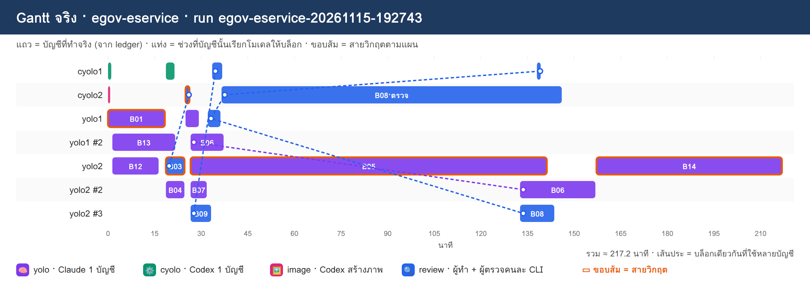
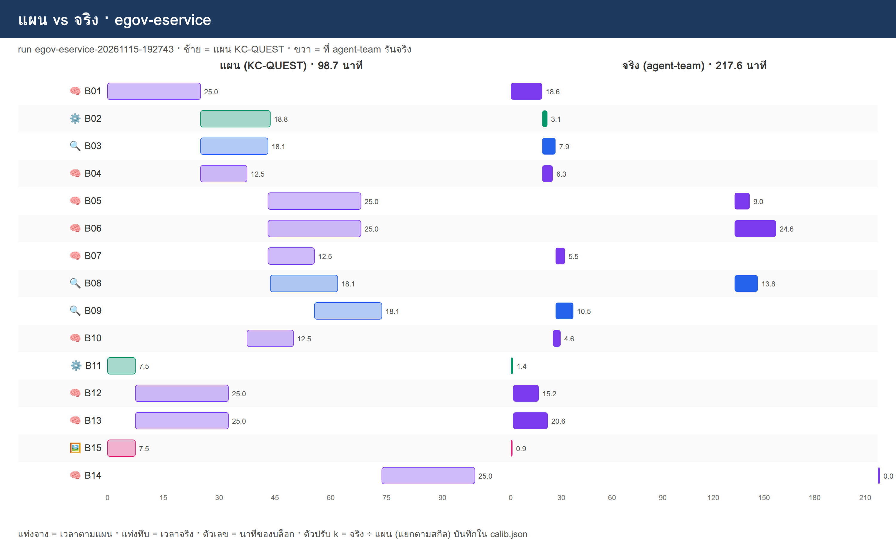

# REPORT · egov-eservice

**run:** `egov-eservice-20261115-192743` · `/workspace/.agent-team/egov-eservice-20261115-192743` · โจทย์: สร้างเว็บ e-Service กลางของเทศบาลนครตัวอย่างตามชุดโจทย์ใน /workspace/egov-brief (อ่าน README.md ก่อน) ต้องทำตาม REQUIREMENTS.md CONTRACT.md TEST-DATA.md DECISIONS.md ครบทุกข้อ รันด้วย Docker Compose คำสั่งเดียว รองรับ TEST_MODE=1 และ BUG_MODE ตาม BUGS.md และมีชุด Playwright ครบ 51 TC ใน TEST-PLAN.md · stack กลางของทุกบล็อก: Node.js 20 + Express + better-sqlite3 (DB_PATH) + หน้า HTML render ฝั่งเซิร์ฟเวอร์ด้วย template literal (ไม่มี build step) + pdfkit + exceljs · เวลาอ่านจาก src/lib/clock.js เท่านั้น (Asia/Bangkok) · บั๊กเปิดผ่าน isBug('Bxx') ใน src/lib/bugs.js

## ตารางบล็อก (แผน vs จริง)

| บล็อก | สกิล | บัญชีแผน | บัญชีจริง | นาทีแผน | นาทีจริง | tokens (ไม่รวม cache read) | ครั้ง | สถานะ | ไฟล์ผล |
|---|---|---|---|---|---|---|---|---|---|
| **B01** | 🧠 yolo | yolo1(ทำ) | yolo1(ทำ) | 25.00 | 18.63 | 344,395 | 1 | ok | ✅ src/server.js |
| B02 | ⚙️ cyolo | cyolo1(ทำ) | cyolo1(ทำ) | 18.75 | 3.12 | 59,041 | 1 | ok | ✅ src/db/seed.js |
| **B03** | 🔍 review | yolo1(ทำ), cyolo2(ตรวจ) | yolo2(ทำ), cyolo2(ตรวจ) | 18.13 | 7.93 | 257,413 | 2 | ok | ✅ src/lib/rules.js |
| B04 | 🧠 yolo | yolo2(ทำ) | yolo2(ทำ) | 12.50 | 6.30 | 190,260 | 1 | ok | ✅ src/routes/auth.js |
| **B05** | 🧠 yolo | yolo1(ทำ) | yolo2(ทำ) | 25.00 | 8.95 | 697,378 | 2 | ok | ✅ src/routes/citizen.js |
| B06 | 🧠 yolo | yolo1(ทำ) | yolo1(ทำ), yolo2(ทำ) | 25.00 | 24.58 | 627,982 | 2 | ok | ✅ src/routes/officer.js |
| B07 | 🧠 yolo | yolo2(ทำ) | yolo2(ทำ) | 12.50 | 5.53 | 177,179 | 1 | ok | ✅ src/routes/documents.js |
| B08 | 🔍 review | yolo2(ทำ), cyolo2(ตรวจ) | yolo1(ทำ), cyolo2(ตรวจ), yolo2(ทำ), cyolo1(ตรวจ) | 18.12 | 13.77 | 615,373 | 6 | ok | ✅ src/lib/notify.js |
| B09 | 🔍 review | yolo1(ทำ), cyolo1(ตรวจ) | yolo2(ทำ), cyolo1(ตรวจ) | 18.12 | 10.52 | 307,264 | 2 | ok | ✅ src/routes/dashboard.js |
| B10 | 🧠 yolo | yolo1(ทำ) | yolo1(ทำ) | 12.50 | 4.63 | 168,359 | 1 | ok | ✅ src/routes/admin.js |
| B11 | ⚙️ cyolo | cyolo2(ทำ) | cyolo1(ทำ) | 7.50 | 1.40 | 34,473 | 1 | ok | ✅ tests/helpers.ts |
| B12 | 🧠 yolo | yolo1(ทำ) | yolo2(ทำ) | 25.00 | 15.23 | 310,741 | 1 | ok | ✅ tests/specs/part-a.spec.ts |
| B13 | 🧠 yolo | yolo1(ทำ) | yolo1(ทำ) | 25.00 | 20.57 | 389,367 | 1 | ok | ✅ tests/specs/part-b.spec.ts |
| B15 | 🖼️ image | cyolo1(ทำ) | cyolo2(ทำ) | 7.50 | 0.93 | 25,574 | 1 | ok | ✅ public/img/logo.png |
| **B14** | 🧠 yolo | yolo1(ทำ) | yolo2(ทำ) | 25.00 | 0.00 | 569,206 | 1 | failed — ไม่มีบัญชีที่พร้อมสำหรับ yolo (kind=None) | ✅ INTEGRATION.md |

- tokens รวมของบล็อก **4,774,005** = ผลรวมจาก ledger ของ run (24 การเรียก) **4,774,005** ✅ ตรงกัน
- การเรียกที่ไม่ใช่บล็อก (ตรวจความพร้อม ฯลฯ): 0 ครั้ง · 0 tokens (ไม่นับในตาราง)
- เวลารวม: แผน 98.7 นาที · จริง 217.6 นาที
- บล็อกเสร็จ 14/15

## ภาพ

## ความต่างระหว่างแผนกับของจริง

- B03: แผน yolo1(ทำ), cyolo2(ตรวจ) → จริง yolo2(ทำ), cyolo2(ตรวจ)
- B05: แผน yolo1(ทำ) → จริง yolo2(ทำ)
- B06: แผน yolo1(ทำ) → จริง yolo1(ทำ), yolo2(ทำ)
- B08: แผน yolo2(ทำ), cyolo2(ตรวจ) → จริง yolo1(ทำ), cyolo2(ตรวจ), yolo2(ทำ), cyolo1(ตรวจ)
- B09: แผน yolo1(ทำ), cyolo1(ตรวจ) → จริง yolo2(ทำ), cyolo1(ตรวจ)
- B11: แผน cyolo2(ทำ) → จริง cyolo1(ทำ)
- B12: แผน yolo1(ทำ) → จริง yolo2(ทำ)
- B15: แผน cyolo1(ทำ) → จริง cyolo2(ทำ)
- B14: แผน yolo1(ทำ) → จริง yolo2(ทำ)
- (export ส่งเป็นฝั่ง yolo/cyolo ไม่ผูกบัญชี เพื่อให้ failover ของ agent-team ทำงาน → agent-team เลือกบัญชีในฝั่งเองตามโหลด/โควตา ดู references/run.md)
- event worker_stop:  → โควตา 84% ≥ เกณฑ์ 80%
- event worker_switch: B08#w1 yolo2→yolo1 บัญชี yolo2 หยุดรับงาน: โควตา 84% ≥ เกณฑ์ 80%
- event worker_stop:  → โควตา 98% ≥ เกณฑ์ 80%
- event worker_switch: B14 yolo1→ บัญชี yolo1 หยุดรับงาน: โควตา 98% ≥ เกณฑ์ 80%
- event worker_stop:  → โควตา 80% ≥ เกณฑ์ 80%

## ตัวปรับเวลา k (calib.json)

`/workspace/plans/calib.json`: {"yolo": 0.6427, "cyolo": 0.1721, "review": 0.5925, "image": 0.1244}

k = นาทีจริง ÷ นาทีแผน (ก่อนคูณ k) แยกตามสกิล · `plan` ครั้งถัดไปคูณเวลาแต่ละบล็อกด้วย k ของสกิลนั้น
